<p align="center">
  
</p>

# 🌐 Awesome Multi-Cloud Infrastructure Management [](https://github.com/ishandutta2007/Awesome-Awesome-Awesome)

> 🚀 A curated list of top SaaS platforms and open-source GitHub projects for **Multi-Cloud Infrastructure Management**, hybrid cloud orchestration, multi-cluster Kubernetes fleets, and unified cloud governance.

<p align="center">
  <a href="https://github.com/ishandutta2007/Awesome-Awesome-Awesome"></a>
  <a href="https://discord.gg/jc4xtF58Ve"></a>
  <a href="https://github.com/ishandutta2007/Awesome-Multi-Cloud-Infrastructure-Management/stargazers"></a>
  <a href="https://opensource.org/licenses/MIT"></a>
  <a href="https://github.com/ishandutta2007"></a>
</p>

📅 **Last updated: November 2026**

This repository tracks notable enterprise **SaaS platforms** and production-grade **open-source projects** for **Multi-Cloud Infrastructure Management**. These tools enable platform engineering teams and enterprises to provision, orchestrate, monitor, and govern compute, storage, and networking resources across Amazon Web Services (AWS), Microsoft Azure, Google Cloud Platform (GCP), and on-premises environments—delivering a unified control plane without vendor lock-in.

---

## 📑 Table of Contents

- [📊 Sector Overview & Market Dynamics](#-sector-overview--market-dynamics)
- [☁️ SaaS & Hosted Platforms](#️-saas--hosted-platforms)
- [🔓 Open-Source GitHub Projects](#-open-source-github-projects)
- [🏗️ Architecture & Tooling Taxonomy](#️-architecture--tooling-taxonomy)
- [⭐ Star History](#-star-history)
- [🤝 Support & Community](#-support--community)
- [✍️ How to Contribute](#️-how-to-contribute)
- [📜 Disclaimer & License](#-disclaimer--license)

---

## 📊 Sector Overview & Market Dynamics

The global multi-cloud management market is valued at approximately **$15.5 billion to $16.9 billion in 2025–2026** and is projected to exceed **$60 billion to $80 billion by 2032–2034**, expanding at a rapid compound annual growth rate (CAGR) of **21% to 28%** driven by enterprise cloud repatriation, FinOps cost governance, and Kubernetes fleet sprawl.

Market concentration remains **moderately fragmented**: while foundational hyper-scale infrastructure is dominated by the big-three cloud providers (AWS, Microsoft, Google), cross-cloud orchestration, observability, and FinOps governance remain an open, highly contested category where specialized multi-cloud vendors (Datadog, HashiCorp/IBM, Nutanix) and independent open-source control planes prevent a winner-take-all monopoly.

---

## ☁️ SaaS & Hosted Platforms

The table below details leading SaaS and managed enterprise platforms for multi-cloud infrastructure orchestration, sorted by **company scale (valuation / market capitalization in descending order)**.

| Platform | Company Valuation / Market Cap | Starting Pricing (Paid Tiers) | Free Tier / Free Trial Limits | Key Capabilities |
| :--- | :--- | :--- | :--- | :--- |
| **[Azure Arc](https://azure.microsoft.com/en-us/products/azure-arc)** | ~$3.1 Trillion *(Microsoft Corp - MSFT)* | Free base control plane; advanced management like Azure Update Manager starts at **$5.00/server/month** | **Free forever** for core control plane (inventory, Azure Resource Graph, tags, RBAC, and extensions); optional 30-day Azure trial with $200 credits | Extends Azure Resource Manager, policy enforcement, and governance across AWS, GCP, and on-prem VMs and Kubernetes clusters. |
| **[Google Anthos (GKE Enterprise)](https://cloud.google.com/anthos)** | ~$2.1 Trillion *(Alphabet Inc - GOOGL)* | Pay-as-you-go starts at **$6.00/vCPU/month** ($0.00822/vCPU/hour) on public clouds; **$24.00/vCPU/month** on-prem | **90-day free trial** with $300 cloud credits across GCP; standard GKE includes a $74.40/month cluster management fee credit per billing account | Unified Kubernetes fleet management across GCP, AWS, Azure, and bare-metal with centralized configuration and service mesh. |
| **[VMware Tanzu](https://tanzu.vmware.com/)** | ~$800 Billion *(Broadcom Inc - AVGO)* | Quoted per-core annual subscription; typical entry configurations start at **~$150 to $350/core/year** | **90-day free evaluation trial** available via Broadcom Support Portal (or 30-day AWS Marketplace trial); TCE community edition retired | Multi-cloud Kubernetes platform and runtime management across private vSphere and major public clouds with unified platform operations. |
| **[Snowflake Multi-Cloud Support](https://www.snowflake.com/)** | ~$55 Billion *(Snowflake Inc - SNOW)* | Standard Edition starts at **$2.00 per capacity credit** (~$2.00–$4.00/credit depending on tier and cloud provider) | **30-day free trial** including **$400 in free usage credits** with no upfront credit card required | Global cross-cloud data cloud layer operating seamlessly across AWS, Azure, and GCP with cross-region replication and data mesh. |
| **[Datadog Multi-Cloud](https://www.datadoghq.com/)** | ~$40 Billion *(Datadog Inc - DDOG)* | Infrastructure Pro starts at **$15.00/host/month** (annual) or $18.00/host/month (on-demand); APM at $31.00/host/month | **Free forever plan** up to **5 hosts** (1-day metric retention); **14-day full-featured free trial** with no credit card required | Comprehensive observability, 900+ multi-cloud integrations, log aggregation, and continuous security posture management across clouds. |
| **[Nutanix Cloud Clusters (NC2)](https://www.nutanix.com/products/nutanix-cloud-clusters)** | ~$16 Billion *(Nutanix Inc - NTNX)* | Pay-as-you-go starts at **$0.104/core/hour** (NCI Pro) or $0.131/core/hour (NCI Ultimate); BYOL license portability supported | **30-day free trial** covering Nutanix software licensing (one trial per supported public cloud; cloud bare-metal VM costs billed separately) | Hybrid cloud workload mobility running Nutanix HCI software natively on AWS and Azure bare metal without app refactoring. |
| **[HashiCorp Terraform Cloud](https://www.hashicorp.com/)** | ~$8.1 Billion *(Acquired by IBM)* | Essentials plan starts at **$0.10 per managed resource/month**; Standard tier starts at **$0.47 per managed resource/month** | **Free forever plan** covering up to **500 managed resources (RUM)** with remote state management and VCS triggers | Managed IaC control plane with remote execution, state locking, drift detection, private module registries, and OPA/Sentinel policies. |
| **[Flexera One](https://www.flexera.com/)** | ~$2.9 Billion *(Valuation at Thoma Bravo buyout)* | Modular enterprise contracts starting from **~$10,000/year** (custom quote based on monitored spend and asset count) | **No self-service free tier**; custom pilot POC / targeted 30-day demo trials available upon request | Enterprise FinOps, multi-cloud cost governance, software asset management (SAM), and hybrid IT estate analytics. |
| **[Morpheus Data](https://www.morpheusdata.com/)** | ~$150 Million *(Acquired by Hewlett Packard Enterprise)* | Morpheus VM Essentials starts at **$600/socket**; full Enterprise CMP suite starts at **$2,500/socket** | **60-day free evaluation trial** supporting up to **6 CPU sockets** | Self-service multi-cloud provisioning engine, cost rightsizing recommendations, and unified control plane for VMs and containers. |

---

## 🔓 Open-Source GitHub Projects

Leading open-source multi-cloud control planes, infrastructure-as-code engines, cluster fleet managers, and FinOps tooling—sorted by **GitHub Stars_Count (descending)**.

| Project | GitHub_Stars | License | Primary Focus | Description |
| :--- | :--- | :--- | :--- | :--- |
| **[Kubernetes](https://github.com/kubernetes/kubernetes)** | [](https://github.com/kubernetes/kubernetes/stargazers) | Apache-2.0 | 🚢 Container Orchestration | The universal foundation of cloud-native multi-cloud deployments; acts as the standard abstraction layer across all clouds. |
| **[Terraform](https://github.com/hashicorp/terraform)** | [](https://github.com/hashicorp/terraform/stargazers) | BUSL-1.1 | 🏗️ Infrastructure-as-Code | Declarative multi-cloud provisioning tool with thousands of ecosystem providers covering AWS, GCP, Azure, and bare metal. |
| **[OpenTofu](https://github.com/opentofu/opentofu)** | [](https://github.com/opentofu/opentofu/stargazers) | MPL-2.0 | 🛡️ Infrastructure-as-Code | Permissive, community-driven, Linux Foundation fork of Terraform providing transparent multi-cloud IaC provisioning. |
| **[Rancher](https://github.com/rancher/rancher)** | [](https://github.com/rancher/rancher/stargazers) | Apache-2.0 | 🤠 Multi-Cluster Management | Complete multi-cloud Kubernetes management platform providing centralized authentication, access control, and fleet governance. |
| **[Pulumi](https://github.com/pulumi/pulumi)** | [](https://github.com/pulumi/pulumi/stargazers) | Apache-2.0 | 💻 Infrastructure-as-Code | Code-first IaC framework allowing developers to define multi-cloud architectures using TypeScript, Python, Go, C#, and YAML. |
| **[Cilium](https://github.com/cilium/cilium)** | [](https://github.com/cilium/cilium/stargazers) | Apache-2.0 | 🐝 Multi-Cloud Networking | eBPF-based networking, observability, and security mesh connecting Kubernetes clusters across heterogeneous clouds via ClusterMesh. |
| **[Argo CD](https://github.com/argoproj/argo-cd)** | [](https://github.com/argoproj/argo-cd/stargazers) | Apache-2.0 | 🐙 Multi-Cluster GitOps | Declarative continuous delivery engine for Kubernetes managing synchronized app deployments across multi-cloud cluster fleets. |
| **[Infracost](https://github.com/infracost/infracost)** | [](https://github.com/infracost/infracost/stargazers) | Apache-2.0 | 💰 Multi-Cloud FinOps | Real-time cloud cost estimates for Terraform and OpenTofu pull requests, preventing budget overruns across AWS, Azure, and GCP. |
| **[Crossplane](https://github.com/crossplane/crossplane)** | [](https://github.com/crossplane/crossplane/stargazers) | Apache-2.0 | ✈️ Cloud Control Plane | Cloud-native control plane orchestrating multi-cloud infrastructure and managed databases directly via Kubernetes CRDs and APIs. |
| **[OKD / OpenShift](https://github.com/openshift/origin)** | [](https://github.com/openshift/origin/stargazers) | Apache-2.0 | 🔴 Enterprise Kubernetes | Upstream community distribution powering Red Hat OpenShift across hybrid datacenters and major cloud hyperscalers. |
| **[OpenTelemetry Collector](https://github.com/open-telemetry/opentelemetry-collector)** | [](https://github.com/open-telemetry/opentelemetry-collector/stargazers) | Apache-2.0 | 🔭 Hybrid Observability | Vendor-agnostic proxy and telemetry collector for metrics, traces, and logs across hybrid and multi-cloud server fleets. |
| **[KubeVirt](https://github.com/kubevirt/kubevirt)** | [](https://github.com/kubevirt/kubevirt/stargazers) | Apache-2.0 | 🖥️ VM & Container Convergence | Enables virtual machines to run natively inside Kubernetes clusters alongside containers across hybrid and multi-cloud nodes. |
| **[OpenCost](https://github.com/opencost/opencost)** | [](https://github.com/opencost/opencost/stargazers) | Apache-2.0 | 🏷️ Multi-Cloud Cost Tracking | CNCF vendor-neutral specification and engine for real-time Kubernetes cluster cost allocation across cloud providers. |
| **[Cloud Custodian](https://github.com/cloud-custodian/cloud-custodian)** | [](https://github.com/cloud-custodian/cloud-custodian/stargazers) | Apache-2.0 | 🛡️ Cloud Governance & Security | Rules engine for cloud security compliance, tag enforcement, garbage collection, and cost reduction across AWS, Azure, and GCP. |
| **[Karmada](https://github.com/karmada-io/karmada)** | [](https://github.com/karmada-io/karmada/stargazers) | Apache-2.0 | 🧭 Multi-Cloud Multi-Cluster | CNCF multi-cloud Kubernetes orchestration system delivering native API multi-cluster application distribution and failover. |
| **[Open Cluster Management (OCM)](https://github.com/open-cluster-management-io/ocm)** | [](https://github.com/open-cluster-management-io/ocm/stargazers) | Apache-2.0 | 🎯 Cluster Governance | Modular hub-and-spoke multi-cluster control plane for policy enforcement, governance, and workload placement across clouds. |
| **[CB-Tumblebug](https://github.com/cloud-barista/cb-tumblebug)** | [](https://github.com/cloud-barista/cb-tumblebug/stargazers) | Apache-2.0 | ☕ Multi-Cloud Infrastructure Framework | Cloud-Barista multi-cloud service management framework orchestrating heterogeneous cloud infrastructure through unified REST APIs. |

---

## 🏗️ Architecture & Tooling Taxonomy

Modern multi-cloud architectures rely on distinct layers of tooling to manage complexity and avoid single-vendor lock-in:

```
+--------------------------------------------------------------------------+
|                       FinOps & Governance Layer                          |
|         Flexera One  |  Infracost  |  OpenCost  |  Cloud Custodian       |
+--------------------------------------------------------------------------+
|                     Observability & Security Mesh                        |
|             Datadog  |  OpenTelemetry Collector  |  Cilium               |
+--------------------------------------------------------------------------+
|                 Multi-Cluster & Fleet Orchestration                      |
|         Azure Arc  |  GKE Enterprise  |  Rancher  |  Karmada  |  OCM     |
+--------------------------------------------------------------------------+
|                   Unified Control Plane & Workloads                      |
|          Crossplane  |  Morpheus Data  |  KubeVirt  |  Nutanix NC2       |
+--------------------------------------------------------------------------+
|                      Infrastructure-as-Code (IaC)                        |
|             Terraform  |  OpenTofu  |  Pulumi  |  Terraform Cloud        |
+--------------------------------------------------------------------------+
|                  Underlying Cloud & Hardware Providers                   |
|           Amazon Web Services (AWS)  |  Microsoft Azure                  |
|           Google Cloud Platform (GCP) |  On-Premise / Bare-Metal Datacenter |
+--------------------------------------------------------------------------+
```

### 💡 Choosing the Right Toolchain
- **For Multi-Cloud Infrastructure Provisioning:** Use **[OpenTofu](https://github.com/opentofu/opentofu)** or **[Terraform](https://github.com/hashicorp/terraform)** for declarative definitions, or **[Pulumi](https://github.com/pulumi/pulumi)** if your team prefers general-purpose programming languages.
- **For Kubernetes Fleet Management & Governance:** Use **[Rancher](https://github.com/rancher/rancher)**, **[Karmada](https://github.com/karmada-io/karmada)**, or **[Azure Arc](https://azure.microsoft.com/en-us/products/azure-arc)** to synchronize policies and container workloads across disparate environments.
- **For Cloud Cost Control & FinOps:** Integrate **[Infracost](https://github.com/infracost/infracost)** into pull requests to catch cost spikes before deployment, and deploy **[OpenCost](https://github.com/opencost/opencost)** or **[Flexera One](https://www.flexera.com/)** for real-time allocation and tracking.
- **For Cross-Cluster Networking & Security:** Deploy **[Cilium](https://github.com/cilium/cilium)** with ClusterMesh to create unified eBPF-powered connectivity across cloud boundaries.

---

## 🌟 Star History

[](https://star-history.dera.page/#ishandutta2007/Awesome-Multi-Cloud-Infrastructure-Management&type=date&legend=top-left)

---

## 🤝 Support & Community

Thank you for visiting this repository! If you find this curated collection of multi-cloud tools and resources helpful, please consider supporting the project:

- ⭐ **Star this repository** to show your appreciation and help other platform engineers discover it.
- 🍴 **Fork and contribute** by submitting your favorite multi-cloud tools, corrections, or updates.
- 📢 **Share this list** with your colleagues, DevOps communities, and on social networks.
- ☕ **Buy me a coffee / Sponsor:** If you'd like to support ongoing curation and maintenance of awesome lists, consider becoming a sponsor via the [GitHub Sponsor Dashboard](https://github.com/sponsors/ishandutta2007).

---

## ✍️ How to Contribute

1. 🍴 Fork the repository.
2. 📝 Add your tool to either the **SaaS & Hosted Platforms** table or the **Open-Source GitHub Projects** table following existing schemas.
3. 🔍 Verify that:
   - For SaaS products, include verifiable starting prices, company valuation/market cap, and exact free tier/trial details.
   - For open-source tools, include the official repository link, active stargazers badge, license, and primary focus.
4. 🚀 Open a pull request with a descriptive title and context.

---

## 📜 Disclaimer & License

- ℹ️ This list is community-curated and provided for informational purposes without formal endorsement.
- 🔒 Multi-cloud infrastructure platforms handling credentials and production workloads must be configured according to strict organizational security and compliance policies.
- 📄 Distributed under the [MIT License](LICENSE).
